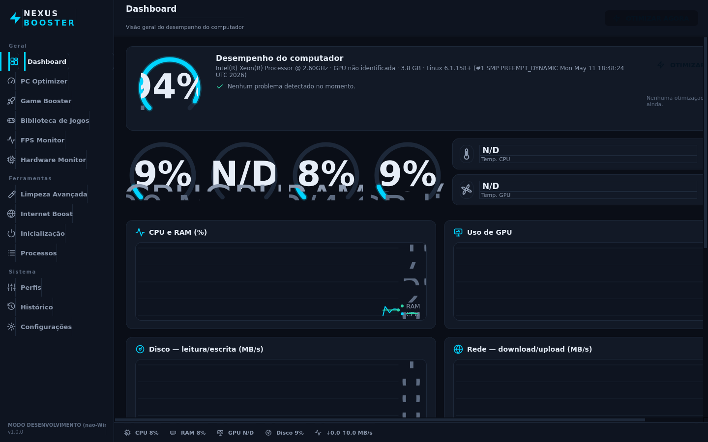

# ⚡ NEXUS BOOSTER

**Otimizador profissional de desempenho para Windows e jogos.**

Aplicativo desktop nativo para **Windows 10/11 (64 bits)** que melhora o desempenho do
computador com ajustes **seguros, explicados e 100% reversíveis** — monitoramento em
tempo real, limpeza avançada, game booster com perfis por jogo e ferramentas de rede
com medições reais.



---

## 📋 Índice

1. [Visão geral](#1-visão-geral)
2. [Requisitos](#2-requisitos)
3. [Instalação (usuário final)](#3-instalação-usuário-final)
4. [Manual de utilização (por aba)](#4-manual-de-utilização-por-aba)
5. [O que o Nexus Booster NUNCA faz](#5-o-que-o-nexus-booster-nunca-faz)
6. [Compilação e empacotamento (desenvolvedor)](#6-compilação-e-empacotamento-desenvolvedor)
7. [Arquitetura do código](#7-arquitetura-do-código)
8. [Execução em modo desenvolvimento](#8-execução-em-modo-desenvolvimento)
9. [Perguntas frequentes](#9-perguntas-frequentes)
10. [Solução de problemas](#10-solução-de-problemas)

---

## 1. Visão geral

O Nexus Booster foi construído com três princípios:

| Princípio | Na prática |
|---|---|
| **Funcionalidade real** | Todo botão executa uma ação real (psutil, WMI, registro, contadores do Windows). Nada é decorativo. |
| **Honestidade de métricas** | FPS, temperatura e uso de GPU só aparecem quando o hardware/fornece. Sem suporte? A interface mostra **"não suportado"** — nunca valores inventados. **Não prometemos aumento garantido de FPS.** |
| **Segurança e reversibilidade** | Cada alteração é explicada, registrada no histórico e reversível. Processos/serviços essenciais e de segurança são **bloqueados** por padrão. |

### Abas do aplicativo

| # | Aba | O que faz |
|---|-----|-----------|
| 1 | **Dashboard** | Status geral, medidores CPU/GPU/RAM/disco, gráficos em tempo real, atalhos |
| 2 | **PC Optimizer** | Plano de energia, efeitos visuais, serviços do Windows, apps em segundo plano |
| 3 | **Game Booster** | Sessão de boost com suspensão reversível de apps e auto-detecção de jogos |
| 4 | **Biblioteca de Jogos** | Detecção automática (Steam, Epic, Riot, Battle.net, Menu Iniciar) + manual |
| 5 | **FPS Monitor** | FPS/frametime reais via PresentMon, análise de gargalo, comparação antes×depois |
| 6 | **Hardware Monitor** | Identificação completa do hardware + monitoramento ao vivo |
| 7 | **Limpeza Avançada** | 12 categorias com análise prévia, seleção individual e relatório |
| 8 | **Internet Boost** | Ping real, teste de velocidade, diagnóstico e recomendação de DNS, reparos |
| 9 | **Inicialização** | Gerenciar apps que iniciam com o Windows (reversível) |
| 10 | **Processos** | Tabela ao vivo com finalizar/suspender/retomar (proteções ativas) |
| 11 | **Perfis** | Perfis por jogo (Fortnite, Valorant, CS2, GTA V, FiveM, LoL…) com recomendações reais |
| 12 | **Histórico** | Registro de todas as alterações com **DESFAZER** + log de erros |
| 13 | **Configurações** | Tema, intervalo, PresentMon, inicialização com o Windows, dados |

---

## 2. Requisitos

- **Windows 10 (1709+) ou Windows 11, 64 bits**
- 4 GB de RAM recomendados · 200 MB de espaço em disco
- **Opcional:** [PresentMon](https://game-tech-dev.github.io/PresentMon/) para medir FPS real
- Para recursos de administrador: conta com permissão de elevação (o app pede UAC quando necessário — funciona também sem administrador, com menos recursos)

## 3. Instalação (usuário final)

### Modo 1 — Instalador pronto (recomendado)

Baixe **`NexusBooster-Setup-1.0.1.exe`** nos [**Releases do GitHub**](https://github.com/xStorm95/Meus-projetos/releases),
dê dois cliques e avance no assistente (atalho na área de trabalho é opcional).

O instalador inclui **desinstalador completo** e prepara o terreno para **atualizações
futuras** (versões novas instalam por cima, mantendo seus dados em `%APPDATA%\NexusBooster`).

### Modo 2 — Pela pasta do projeto (sem instalador)

1. Extraia o ZIP e entre na pasta `NexusBooster`
2. Duplo clique em **`INSTALAR-E-ABRIR.bat`** — instala tudo sozinho
   (Python + dependências, se necessário) e abre o app
3. Nos próximos dias, use **`ABRIR-NEXUS-BOOSTER.bat`**

Detalhes em `COMO-INSTALAR.txt`.

> 💡 **Dica:** clique em *"Reiniciar como administrador"* na aba Configurações para
> liberar recursos que precisam de elevação (serviços, pasta Temp do Windows, Winsock).
> O aplicativo funciona normalmente sem isso.

---

## 4. Manual de utilização (por aba)

### 🏠 Dashboard

Ao abrir, o Nexus Booster identifica seu hardware (CPU, GPU, RAM, discos, placa-mãe)
e começa a monitorar em tempo real.

- **Anel "Status geral"** — índice simplificado calculado com métricas atuais
  (CPU, RAM, espaço em disco, itens de inicialização). É um guia, não uma nota absoluta.
- **Medidores** — CPU, GPU, RAM e disco com temperaturas quando suportadas.
  Se a GPU for NVIDIA, temperatura/uso vêm do driver (NVML). Outras GPUs usam os
  contadores do Windows. Sem suporte → "N/D".
- **Botão OTIMIZAR AGORA** — abre o assistente (veja abaixo).
- **Cartões inferiores** — atalhos para Biblioteca, Inicialização, Limpeza e Histórico.

**Assistente de otimização** (o que cada etapa faz, com risco e opção de ponto de restauração):

| Etapa | Descrição | Reversível |
|---|---|---|
| Limpeza rápida | Temporários do usuário + caches de shader + relatórios de erro antigos | ✅ (arquivos apagados, mas apenas caches) |
| Plano de energia | Ativa/cria o plano "Nexus Booster — Desempenho" | ✅ restaura o anterior |
| Efeitos visuais | Desativa transparências/animações não essenciais (fontes preservadas) | ✅ valores originais salvos |
| Cache DNS | `ipconfig /flushdns` | — |
| Suspender apps | Suspende (não fecha) apps da lista do perfil | ✅ retoma automaticamente |

### 🚀 Game Booster

1. Clique **Iniciar boost rápido** (ou inicie por um jogo na Biblioteca com ⚡)
2. O app ativa o plano de energia e **suspende** os apps configurados — eles ficam
   congelados na memória, prontos para voltar
3. Ao encerrar (botão ou quando o jogo fecha), **tudo é restaurado automaticamente**

Ative **detecção automática** para o Nexus Booster perceber quando você abre um jogo
da biblioteca — com **boost automático** opcional. Nada é enviado para a internet.

### 🎮 Biblioteca de Jogos

- **Detectar jogos** — varre Steam (bibliotecas + manifestos), Epic Games (manifestos),
  Riot Games (VALORANT/LoL) e atalhos do Menu Iniciar (Battle.net, EA, Ubisoft, GOG, Xbox…)
- **Adicionar manualmente** — nome + executável, com detecção automática de perfil
- Cada cartão tem: ★ favoritar · ▶ jogar · ⚡ otimizar e jogar
- O perfil certo é aplicado por nome/executável (veja a aba Perfis)

### 📊 FPS Monitor

O FPS é lido do **PresentMon** (ferramenta oficial Intel/GPUOpen) — captura a
apresentação real de quadros do processo do jogo:

1. Baixe o PresentMon (link na própria aba) e informe o caminho em Configurações
2. Com o jogo aberto, selecione o processo e clique **Iniciar captura**
3. Veja FPS atual/médio/1% low, frametime e a **análise de gargalo**
   (heurística com uso real de CPU×GPU — informativa, não definitiva)
4. **Registrar resultado** permite comparar antes × depois de otimizações

> ⚠️ Sem PresentMon o recurso fica marcado como **não suportado** — por decisão de
> projeto, o Nexus Booster não estima FPS.

### 🧹 Limpeza Avançada

1. **Analisar espaço** — calcula o recuperável por categoria (nada é apagado)
2. Marque as categorias desejadas (riscos e descrições em cada linha)
3. **Limpar selecionados** — confirmação → execução → **relatório completo**

Proteções ativas: apenas pastas de cache/temporários aprovadas; documentos, fotos,
jogos, saves e configurações **nunca** são tocados; arquivos em uso são preservados;
arquivos criados nos últimos 10 minutos ficam de fora.

### 🌐 Internet Boost

- **Ping** — ICMP real (comando do sistema, saída multilíngue) + monitor contínuo TCP
- **Velocidade** — download/upload reais com o servidor da Cloudflare (estimativa)
- **DNS** — mostra os servidores ativos, mede a latência dos DNS populares
  (Cloudflare, Google, Quad9, OpenDNS) e recomenda o mais rápido **medido**
- **Aplicar DNS** — só com sua confirmação + UAC; reversível pelo Histórico
- **Reparos** — flush DNS (seguro), renovar DHCP, redefinir Winsock (com avisos)

### ⚙️ Outras abas

- **PC Optimizer** — planos de energia (reversíveis), efeitos visuais (item a item),
  serviços com catálogo de segurança e apps de segundo plano
- **Inicialização** — ativa/desativa itens; desativar guarda tudo em backup
  (registro ou pasta) para reativar depois; itens de segurança são bloqueados
- **Processos** — tabela ao vivo (2 s) com filtro, finalizar/suspender/retomar;
  processos essenciais aparecem destacados e são protegidos
- **Histórico** — tudo que o app fez, com **Desfazer** por item e **DESFAZER
  OTIMIZAÇÕES** (reverte tudo em ordem inversa) + registro de erros
- **Configurações** — cor de destaque (neon/ciano/violeta), intervalo de
  monitoramento, PresentMon, iniciar com o Windows, pasta de dados, reset

---

## 5. O que o Nexus Booster NUNCA faz

- ❌ Não desativa Windows Defender, Firewall, Windows Update ou serviços essenciais
- ❌ Não finaliza/suspende processos críticos do Windows (lista de proteção ativa)
- ❌ Não apaga documentos, fotos, jogos, saves ou configurações
- ❌ Não altera DNS, serviços ou registro sem sua confirmação explícita
- ❌ Não promete aumento garantido de FPS nem inventa métricas
- ❌ Não aplica tweaks genéricos perigosos ("zerar serviços", "desativar 50 serviços")

---

## 6. Compilação e empacotamento (desenvolvedor)

### Estrutura de entrega

```
NexusBooster/
├── main.py                     # ponto de entrada
├── requirements.txt            # dependências
├── pyproject.toml              # metadados do pacote
├── nexus/                      # código-fonte (ver seção 7)
├── assets/                     # logo.svg + icon.ico (gerado)
├── packaging/
│   ├── windows/
│   │   ├── nexusbooster.spec   # spec do PyInstaller
│   │   ├── version_info.txt    # versão do .exe
│   │   └── build.bat           # gera dist/NexusBooster.exe
│   └── installer/
│       ├── nexusbooster.iss    # script Inno Setup
│       └── build_installer.bat # gera NexusBooster-Setup-1.0.1.exe
├── tools/
│   ├── make_icon.py            # logo.svg → icon.ico
│   ├── dev_ui_check.py         # verificação headless da interface
│   └── take_screenshots.py     # screenshots automáticos
└── tests/test_core.py          # testes de lógica (19 testes)
```

### Gerar o .EXE (Windows)

Jeito automático (nuvem): todo push que altera `NexusBooster/**` dispara o workflow
**"Nexus Booster — Build Windows"** (GitHub Actions), que compila o instalador e
publica em [Releases](https://github.com/xStorm95/Meus-projetos/releases). Também pode
ser disparado manualmente na aba *Actions* do repositório.

Jeito local:

```bat
cd NexusBooster
packaging\windows\build.bat
```

O script: cria venv → instala dependências → gera o ícone → compila com PyInstaller
(**sem console**, ícone e versão embutidos) → gera `dist\NexusBooster.exe`.

### Gerar o instalador

Pré-requisito: [Inno Setup 6](https://jrsoftware.org/isdl.php) + `dist\NexusBooster.exe` gerado.

```bat
packaging\installer\build_installer.bat
```

Saída: `installer_output\NexusBooster-Setup-1.0.1.exe` — instalação simples, atalho
opcional na área de trabalho, desinstalador, tarefas opcionais (iniciar com o Windows)
e suporte a atualizações (versões futuras sobrescrevem mantendo dados).

---

## 7. Arquitetura do código

```
nexus/
├── app.py                  # bootstrap (logging, serviços, tema, janela)
├── services.py             # contêiner de serviços (DI)
├── constants.py
├── core/
│   ├── paths.py            # pastas por SO (%APPDATA%\NexusBooster)
│   ├── logging_setup.py    # log rotativo + captura de erros p/ banco
│   ├── database.py         # SQLite (histórico, jogos, erros, benchmarks)
│   ├── settings.py         # preferências com defaults
│   ├── worker.py           # tasks assíncronas (QThread + sinais)
│   ├── safety.py           # listas de proteção + validação de exclusão
│   └── elevation.py        # UAC via ShellExecuteW "runas"
├── system/
│   ├── monitor_service.py  # thread de monitoramento (1 Hz padrão)
│   ├── hardware.py         # identificação (registro → WMI/PS → psutil)
│   ├── gpu_nvidia.py       # NVML (opcional)
│   ├── windows_gpu.py      # contadores de GPU do Windows (Intel/AMD)
│   ├── processes.py        # listagem/kill/suspend/resume com guardas
│   ├── fps_monitor.py      # sessão PresentMon (CSV tail)
│   ├── powershell.py       # helpers PS + JSON
│   └── registry_utils.py   # acesso ao registro
├── optimization/
│   ├── engine.py           # orquestrador com histórico + undo
│   ├── cleaner.py          # 12 categorias com análise/relatório
│   ├── startup.py          # inicialização reversível (registro/pastas)
│   ├── services_win.py     # serviços com catálogo de segurança
│   ├── power.py            # planos de energia
│   ├── visual_effects.py   # efeitos visuais reversíveis
│   └── restore_point.py    # Checkpoint-Computer (elevação)
├── games/
│   ├── scanner.py          # Steam/Epic/Riot/Menu Iniciar (parser VDF próprio)
│   ├── profiles.py         # perfis por jogo com recomendações reais
│   └── booster.py          # sessão de boost + watchdog
├── network/diagnostics.py  # ping TCP/ICMP, velocidade, DNS, reparos
└── ui/
    ├── theme.py            # QSS (tema escuro + azul neon)
    ├── icons.py            # ícones SVG renderizados em runtime
    ├── components.py       # gauges, gráficos, toggles, toasts, cards…
    ├── dialogs.py          # diálogos auxiliares
    ├── optimizer_wizard.py # assistente "OTIMIZAR AGORA"
    ├── main_window.py      # janela + sidebar + statusbar
    └── tabs/               # as 13 abas (dashboard.py, …, settings_tab.py)
```

**Decisões técnicas:**

- **SQLite** com WAL para histórico/undo — nada de arquivos soltos;
- **Undo por payload**: cada alteração registra exatamente o estado anterior;
- **Elevação pontual**: o app roda normal; ações administrativas abrem UAC individual;
- **Fallbacks em cascata**: Registro → PowerShell/WMI → psutil (sempre degrada com
  honestidade em vez de falhar);
- **Thread de monitoramento dedicada** com sinais Qt — a UI nunca trava em I/O;
- **Sem dependência de internet** para funcionar (teste de velocidade é opcional).

## 8. Execução em modo desenvolvimento

```bash
cd NexusBooster
python -m venv .venv
.venv\Scripts\activate            # Windows  (Linux: source .venv/bin/activate)
pip install -r requirements.txt
python main.py
```

Testes:

```bash
python tests/test_core.py                          # 19 testes de lógica
QT_QPA_PLATFORM=offscreen python tools/dev_ui_check.py   # UI headless (13 abas)
QT_QPA_PLATFORM=offscreen python tools/take_screenshots.py
```

## 9. Perguntas frequentes

**O app promete mais FPS?**
Não. O Nexus Booster otimiza recursos do sistema e recomenda ajustes reais de cada
jogo. O ganho varia por máquina — por isso o FPS Monitor existe: para você **medir**
antes e depois com dados reais.

**A temperatura da minha CPU aparece "N/D".**
A leitura de temperatura depende do sensor ACPI/placa-mãe. Em muitos desktops
comerciais o Windows não expõe esse valor ao WMI — é uma limitação do hardware,
não um bug. Soluções de vendors (HWiNFO) usam drivers próprios.

**Preciso de administrador?**
Não para o dia a dia. Serviços, Temp do Windows, Winsock e DNS pedem elevação
pontual (UAC). A aba Configurações tem o botão para reiniciar como administrador.

**Suspender app é perigoso?**
Não — suspender congela o processo na memória (retomado depois). É mais seguro que
finalizar. Ainda assim, processos essenciais são bloqueados.

**Onde ficam meus dados?**
`%APPDATA%\NexusBooster\` — banco `nexus.db`, logs em `logs\`, backups de
inicialização em `startup_backup\`. Removê-los não afeta o Windows.

## 10. Solução de problemas

| Sintoma | Solução |
|---|---|
| "Sem privilégios de administrador" na barra lateral | Configurações → Reiniciar como administrador |
| PresentMon encerra ao iniciar | Algumas versões exigem admin — reinicie o app elevado |
| Uso de GPU "não suportado" | Sem NVIDIA/contadores — GPUs antigas ou drivers sem suporte |
| Teste de velocidade falha | Verifique conexão/proxy; o teste usa `speed.cloudflare.com` |
| Serviço não aparece | Só serviços catalogados como seguros aparecem como ajustáveis — por design |
| App não abre | Veja `%APPDATA%\NexusBooster\logs\nexus.log` |

---

**Nexus Booster v1.0.1** · Python 3.12 · PySide6 · psutil · SQLite
